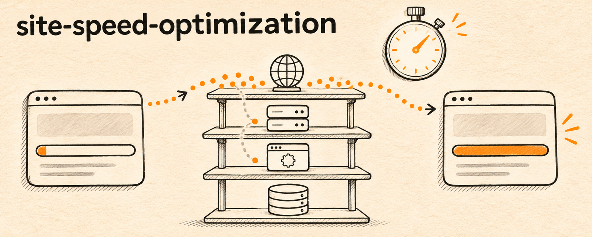

<p align="center">
  
</p>

<p align="center">
  <a href="README.md">English</a> · <b>한국어</b>
</p>

# site-speed-optimization

**느린 웹사이트를 진단부터 측정으로 확인한 개선까지, 코딩 에이전트에게 스킬 하나로 맡깁니다.**

## 무엇인가

Claude Code, Codex 등 `SKILL.md`를 읽는 도구에서 쓰는 에이전트 스킬입니다. 단계마다 무엇을 실행할지, 증상을 어떤 원인과 연결할지, 스택별로 어떤 설정을 바꿀지, 바꾼 게 정말 효과가 있었는지 어떻게 증명할지를 알려줍니다. 스킬 본문은 한국어이고 스크립트, 옵션, 코드는 영어입니다.

## 왜 만들었나

기존 성능 스킬들은 브라우저 쪽에 집중합니다. Lighthouse 점수, LCP, 번들 크기 같은 것들입니다. 실제 사이트에 돌려 보니 콘텐츠 사이트에서 가장 중요한 경우가 많은 계층, 즉 CDN이 HTML을 실제로 캐시해서 내주는지를 놓쳤습니다. HIT/MISS, 캐시된 페이지의 쿠키, 무효화 범위를 확인하는 스킬이 없었습니다. 처음 세운 규칙("Set-Cookie가 붙은 공개 HTML은 누출")은 요청마다 엣지가 새 쿠키를 붙이는 실제 사이트에서 오탐을 냈고, curl 기본 User-Agent는 봇 차단용 403 페이지를 받았는데 그 헤더가 정상 응답처럼 보였습니다. 이 스킬은 세 가지를 모두 처리하고, 공개된 두 사례(GeekNews의 작은 서버 캐시 설계, X의 웹 재구축)를 함께 담았습니다.

## 하는 일

| 단계 | 에이전트가 실행 | 에이전트가 보고 |
|---|---|---|
| 1. 스택 파악 | `package.json`, 설정 파일, 응답 헤더 | 프레임워크와 버전, 렌더링 방식, CDN, DB |
| 2. 주 지표 | 사용자가 기다리는 순간 고르기 | 예: 첫 게시물 표시 시간, 대표 URL 2~5개 |
| 3. 기준선 | `lh-compare.mjs --slow`, `check-cache.sh`, PSI/CrUX | 중앙값, 최소/최대, 실사용 p75, 캐시 경고 |
| 4. 원인 분류 | 증상 → 원인 표, DevTools 트레이스 | 영향 순 원인 목록과 근거 |
| 5. 해법 적용 | 해당 `references/` 문서와 스택 절 | 바꾼 파일과 설정, 이유 |
| 6. 검증 | `lh-compare.mjs <전> <후>` | 전후 중앙값, 95% 신뢰구간, **나빠진 지표 포함** |

references는 캐시(계층, `Cache-Control` 레시피, 개인화 분리, 콘텐츠 나이별 TTL, 무효화, 캐시 키, CDN별 차이), 렌더링, 프론트엔드, 백엔드, 스택(Next.js 14/15/16, Cloudflare, Vercel, Nginx + CloudFront, Astro, Remix), 측정, 전환을 다룹니다. `references/conflicts.md`에는 출처끼리 말이 달랐던 21곳과 각각의 판정을 적었습니다.

## 예시

캐시된 HTML에 세션 쿠키를 붙이는 로컬 테스트 서버에 `check-cache.sh`를 돌린 실제 출력입니다.

```text
$ ./scripts/check-cache.sh http://127.0.0.1:8702/post/y 3 --interval 0 --cookie "sid=1"
URL: http://127.0.0.1:8702/post/y
Cookie: (sent)
#   status ttfb_ms  cache       age    cookie enc
1   200    0        MISS               yes
2   200    0        HIT                yes
3   200    0        HIT                yes

Headers (last response):
  cache-control:     public, s-maxage=60
  cf-cache-status:   HIT
  vary:              Cookie
  content-type:      text/html
  set-cookie:        present

Warnings:
  - CRITICAL (likely): cached HTML responses (HIT) repeat the same Set-Cookie value for: sid. The cookie was probably stored in the shared cache and is sent to every visitor. Confirm with a larger --interval; CloudFront does this when cookies are forwarded.
  - Vary includes Cookie: every distinct cookie gets its own cache entry, so shared caching almost never hits. Vercel does not cache Vary: Cookie responses at all.
  - no content-encoding: the response is not compressed (gzip/br/zstd) for a client that accepts it.
```

기존 서버와 새 서버를 비교한 `parity.mjs` 출력입니다(차이가 있어 종료 코드 1).

```text
$ node scripts/parity.mjs --a http://127.0.0.1:8701 --b http://127.0.0.1:8702 --paths paths.txt --ua googlebot
Checked 3 path(s): 2 differ, 1 match.

path     field     A              B
/post/1  title     Post 1 | Site  Post 1 - Site
/post/1  robots    index,follow   noindex
/post/1  og:title  Post 1 | Site  Post 1 - Site
/post/1  hreflang  2              1
/post/1  jsonld    Article        Article, BreadcrumbList
/old     status    301            302

Warnings:
  /big: b: HTML is 2.32MB, over Googlebot's 2MB limit
```

## 필요한 것

- Node.js 20 이상 (Lighthouse 13은 22.19 이상이 필요합니다. 그보다 낮으면 스크립트가 `lighthouse@12`를 자동으로 씁니다)
- Lighthouse 측정용 Chrome 또는 Chromium
- `check-cache.sh`용 bash와 curl

프로젝트에 아무것도 설치하지 않습니다. Lighthouse는 `npx`로 실행합니다.

## 설치

Claude Code 플러그인:

```bash
claude plugin marketplace add nathankim0/site-speed-optimization
```

```bash
claude plugin install site-speed-optimization@site-speed-optimization
```

또는 스킬 폴더에 바로 클론합니다(Claude Code, Codex, `SKILL.md`를 읽는 다른 도구):

```bash
git clone https://github.com/nathankim0/site-speed-optimization ~/.claude/skills/site-speed-optimization
```

```bash
git clone https://github.com/nathankim0/site-speed-optimization ~/.codex/skills/site-speed-optimization
```

## 사용법

에이전트에게 평소 말로 요청하면 됩니다. 예: "상품 페이지가 모바일에서 느려, 원인 찾아서 고쳐줘", "our product pages are slow on mobile, find out why and fix it". 스킬은 알아서 불러옵니다.

스크립트는 따로도 쓸 수 있습니다.

```bash
./scripts/check-cache.sh https://example.com/ 3
./scripts/check-cache.sh https://example.com/ 3 --cookie "session=..." --json
node scripts/lh-compare.mjs https://example.com/ --runs 7 --slow
node scripts/lh-compare.mjs https://old.example.com/p/1 https://new.example.com/p/1 --runs 9 --slow
node scripts/parity.mjs --a https://old.example.com --b https://new.example.com --paths paths.txt
```

모든 스크립트가 `--help`를 지원합니다.

## 저장소 구조

```text
SKILL.md                   진입점: 원칙, 절차, 증상 표, 체크리스트
references/                caching, rendering, frontend, backend, stacks, measurement,
                           migration, case-studies, conflicts
scripts/check-cache.sh     캐시 헤더, HIT/MISS, 캐시된 쿠키, 압축
scripts/lh-compare.mjs     Lighthouse 반복 측정, A/B 중앙값, 부트스트랩 95% 신뢰구간
scripts/parity.mjs         두 서버의 SEO와 응답 동등성 비교
examples/                  nginx 마이크로캐시, lighthouserc.json, web-vitals 전송
.claude-plugin/            Claude Code 플러그인과 마켓플레이스 매니페스트
```

## 참고한 것

[addyosmani/web-quality-skills](https://github.com/addyosmani/web-quality-skills), [cloudflare/skills](https://github.com/cloudflare/skills)(`web-perf`), [nimajafari/lighthouse-skill](https://github.com/nimajafari/lighthouse-skill)을 직접 돌려 비교했고, 두 사례 [GeekNews의 작은 서버 캐시 설계](https://hada.io/blog/geeknews-cache-on-a-budget/)와 [X의 웹 재구축](https://blog.x.com/en/engineering/rebuilding-the-global-town-square-from-scratch)을 바탕으로 했습니다. 문장은 가져오지 않았습니다. 자세한 내용은 [ATTRIBUTIONS.md](ATTRIBUTIONS.md)에 있습니다.

## 라이선스

MIT
