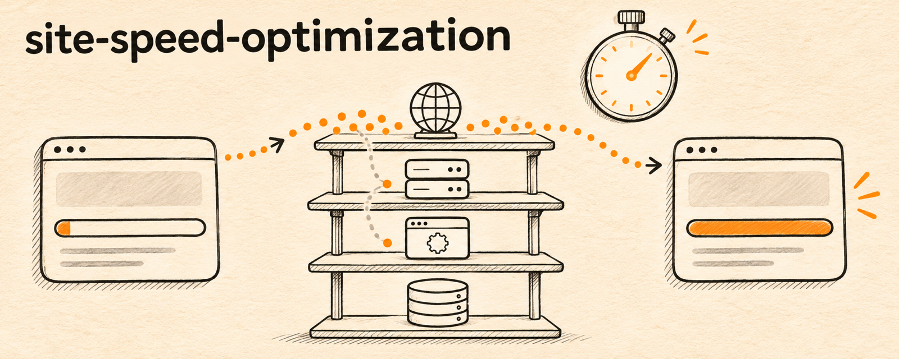

<p align="center">
  
</p>

<p align="center">
  <b>English</b> · <a href="README.ko.md">한국어</a>
</p>

# site-speed-optimization

**Give your coding agent one skill that takes a slow website from diagnosis to a measured fix.**

## What it is

An agent skill for Claude Code, Codex, and other tools that read `SKILL.md`. It tells the agent what to run at each step, how to map a symptom to its cause, which setting to change for your stack, and how to prove the change helped. The skill text is in Korean; scripts, flags, and code are in English.

## Why it exists

Existing performance skills focus on the browser: Lighthouse scores, LCP, bundle size. When we ran them on real sites, they missed the layer that usually matters most for content sites: whether the CDN actually serves the HTML. None of them checked HIT/MISS, cookies on cached pages, or invalidation scope. One rule we wrote first ("public HTML with Set-Cookie is a leak") fired a false alarm on a real site whose edge adds a fresh cookie per request, and curl's default user agent got a 403 bot-block page whose headers looked like a real answer. This skill handles all three, and combines that with two detailed public case studies (GeekNews caching on a small budget, and X's web rebuild).

## What it does

| Step | The agent runs | The agent reports |
|---|---|---|
| 1. Stack | `package.json`, config files, response headers | framework and version, rendering mode, CDN, DB |
| 2. Main metric | picks the moment users wait for | e.g. time to first post, plus 2 to 5 representative URLs |
| 3. Baseline | `lh-compare.mjs --slow`, `check-cache.sh`, PSI/CrUX | medians, min/max, field p75, cache warnings |
| 4. Classify | symptom → cause table, DevTools trace | causes ranked by impact, each with evidence |
| 5. Fix | the matching `references/` file and stack section | files and settings changed, and why |
| 6. Verify | `lh-compare.mjs <before> <after>` | before/after medians, 95% CI, **including metrics that got worse** |

References cover caching (cache layers, `Cache-Control` recipes, personalization split, TTL by content age, invalidation, cache keys, CDN differences), rendering, frontend, backend, stacks (Next.js 14/15/16, Cloudflare, Vercel, Nginx + CloudFront, Astro, Remix), measurement, and migration. `references/conflicts.md` records 21 places where sources disagreed and how the skill rules on each.

## Example

Real output from `check-cache.sh` against a local test server that sets a session cookie on cached HTML:

```text
$ ./scripts/check-cache.sh http://127.0.0.1:8702/post/y 3 --interval 0 --cookie "sid=1"
URL: http://127.0.0.1:8702/post/y
Cookie: (sent)
#   status ttfb_ms  cache       age    cookie enc
1   200    0        MISS               yes
2   200    0        HIT                yes
3   200    0        HIT                yes

Headers (last response):
  cache-control:     public, s-maxage=60
  cf-cache-status:   HIT
  vary:              Cookie
  content-type:      text/html
  set-cookie:        present

Warnings:
  - CRITICAL (likely): cached HTML responses (HIT) repeat the same Set-Cookie value for: sid. The cookie was probably stored in the shared cache and is sent to every visitor. Confirm with a larger --interval; CloudFront does this when cookies are forwarded.
  - Vary includes Cookie: every distinct cookie gets its own cache entry, so shared caching almost never hits. Vercel does not cache Vary: Cookie responses at all.
  - no content-encoding: the response is not compressed (gzip/br/zstd) for a client that accepts it.
```

And from `parity.mjs`, comparing an old and a new server (exit code 1 because they differ):

```text
$ node scripts/parity.mjs --a http://127.0.0.1:8701 --b http://127.0.0.1:8702 --paths paths.txt --ua googlebot
Checked 3 path(s): 2 differ, 1 match.

path     field     A              B
/post/1  title     Post 1 | Site  Post 1 - Site
/post/1  robots    index,follow   noindex
/post/1  og:title  Post 1 | Site  Post 1 - Site
/post/1  hreflang  2              1
/post/1  jsonld    Article        Article, BreadcrumbList
/old     status    301            302

Warnings:
  /big: b: HTML is 2.32MB, over Googlebot's 2MB limit
```

## Requirements

- Node.js 20 or later (Lighthouse 13 needs 22.19+; on older Node the script uses `lighthouse@12` automatically)
- Chrome or Chromium for Lighthouse runs
- bash and curl for `check-cache.sh`

Nothing is installed into your project. Lighthouse runs through `npx`.

## Install

Claude Code plugin:

```bash
claude plugin marketplace add nathankim0/site-speed-optimization
```

```bash
claude plugin install site-speed-optimization@site-speed-optimization
```

Or clone it into a skills folder (Claude Code, Codex, or any tool that reads `SKILL.md`):

```bash
git clone https://github.com/nathankim0/site-speed-optimization ~/.claude/skills/site-speed-optimization
```

```bash
git clone https://github.com/nathankim0/site-speed-optimization ~/.codex/skills/site-speed-optimization
```

## Usage

Ask your agent in plain words, for example "our product pages are slow on mobile, find out why and fix it" or "사이트가 느려, 원인 찾아서 고쳐줘". The skill loads on its own.

The scripts also work by themselves:

```bash
./scripts/check-cache.sh https://example.com/ 3
./scripts/check-cache.sh https://example.com/ 3 --cookie "session=..." --json
node scripts/lh-compare.mjs https://example.com/ --runs 7 --slow
node scripts/lh-compare.mjs https://old.example.com/p/1 https://new.example.com/p/1 --runs 9 --slow
node scripts/parity.mjs --a https://old.example.com --b https://new.example.com --paths paths.txt
```

Every script supports `--help`.

## Repository layout

```text
SKILL.md                   entry point: principles, workflow, symptom table, checklists
references/                caching, rendering, frontend, backend, stacks, measurement,
                           migration, case-studies, conflicts
scripts/check-cache.sh     cache headers, HIT/MISS, cached cookies, compression
scripts/lh-compare.mjs     repeated Lighthouse runs, A/B medians, bootstrap 95% CI
scripts/parity.mjs         SEO and response parity between two servers
examples/                  nginx microcache, lighthouserc.json, web-vitals beacon
.claude-plugin/            Claude Code plugin and marketplace manifests
```

## Credits

Built by running and comparing [addyosmani/web-quality-skills](https://github.com/addyosmani/web-quality-skills), [cloudflare/skills](https://github.com/cloudflare/skills) (`web-perf`), and [nimajafari/lighthouse-skill](https://github.com/nimajafari/lighthouse-skill), plus two case studies: [GeekNews on caching with a small server](https://hada.io/blog/geeknews-cache-on-a-budget/) and [X's web rebuild](https://blog.x.com/en/engineering/rebuilding-the-global-town-square-from-scratch). No text was copied; see [ATTRIBUTIONS.md](ATTRIBUTIONS.md).

## License

MIT
